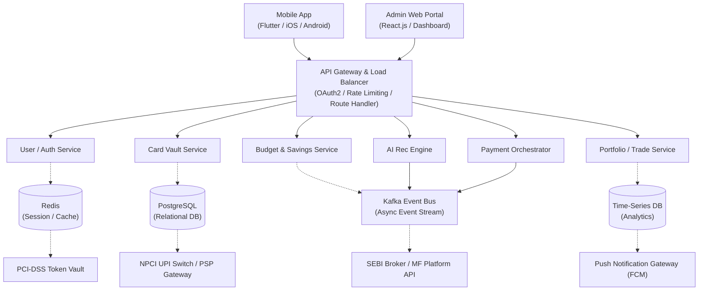

# SmartWallet — System Architecture

This documents the high-level microservices architecture already designed for SmartWallet, so the diagram and the written description stay in sync in the repo.

## Diagram

## Component Descriptions

### Client layer
- **Mobile App (Flutter / iOS / Android)** — the primary user-facing surface for all five modules (Card Vault, AI Assistant, Payments, Portfolio, Budget).
- **Admin Web Portal (React.js / Dashboard)** — internal tool for managing the reward catalog, monitoring transaction volume, and reviewing flagged activity. Not user-facing.

### Gateway layer
- **API Gateway & Load Balancer** — single entry point for both clients. Handles OAuth2 authentication, rate limiting, and routes requests to the correct backend service. No business logic lives here.

### Service layer (backend microservices)
- **User / Auth Service** — signup, login, token issuance/refresh, session management. Backed by Redis for fast session lookups.
- **Card Vault Service** — card CRUD and reward-catalog matching (FR-1, FR-2). Backed by PostgreSQL; sensitive fields never leave this service unencrypted.
- **AI Rec Engine** — scores and ranks cards for a given spend category (FR-3). Publishes recommendation events to Kafka for downstream logging/auditability.
- **Payment Orchestrator** — initiates UPI/NFC payments (FR-4) by orchestrating calls to the sandboxed PSP/tokenization layer; publishes transaction events to Kafka.
- **Budget & Savings Service** — tracks daily spend against budget, generates notifications and month-end recommendations (FR-6, FR-7, FR-8). Consumes transaction events from Kafka.
- **Portfolio / Trade Service** — portfolio valuation and buy/sell order handling (FR-5). Writes performance data to the time-series DB for analytics.

### Event layer
- **Kafka Event Bus** — decouples services so a single transaction event can simultaneously update rewards, budget tracking, and recommendation history without services calling each other directly. This is what implements the report's core differentiator: one event, three downstream effects.

### Data layer
- **Redis** — session cache, short-lived tokens.
- **PostgreSQL** — system of record for users, cards, transactions, budgets.
- **Time-Series DB** — portfolio valuation history and analytics queries (XIRR, allocation trends over time).

### External / regulated partners (sandboxed for this academic build)
- **PCI-DSS Token Vault** — tokenizes card data; SmartWallet never stores raw PAN/CVV.
- **NPCI UPI Switch / PSP Gateway** — executes the actual UPI payment rail.
- **SEBI Broker / MF Platform API** — executes real trade orders (equities, mutual funds, SIPs).
- **Push Notification Gateway (FCM)** — delivers daily and month-end notifications to the mobile app.

## Design principle

SmartWallet's own backend never directly custodies funds, securities, or unmasked card credentials — every regulated action (tokenization, UPI settlement, trade execution) is delegated to a licensed or sandboxed external partner behind a well-defined service interface. The backend's role is orchestration and intelligence (recommendation, budgeting, aggregation), not acting as a bank, broker, or payment aggregator itself.

## Consistency check against SRS / ER diagram

| Requirement | Backing service |
|---|---|
| FR-1, FR-2 | Card Vault Service |
| FR-3 | AI Rec Engine |
| FR-4 | Payment Orchestrator |
| FR-5 | Portfolio / Trade Service |
| FR-6, FR-7, FR-8 | Budget & Savings Service |
| FR-9 | Card Vault Service + Payment Orchestrator (transaction history spans both) |
| Auditability (NFR) | Kafka Event Bus (every event is a durable, replayable log) |
