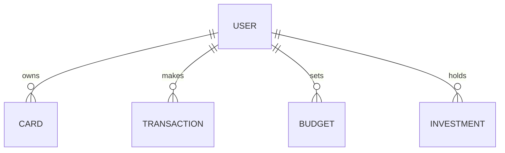

# ER Diagram

> **Status:** Placeholder — to be filled in during Week 1 documentation task.

---

## Entities

- User
- Card
- Transaction
- Budget
- Investment
- ForexRate
- Notification

## Relationships

> Insert ER diagram (Mermaid or image) here once the schema is finalized.

