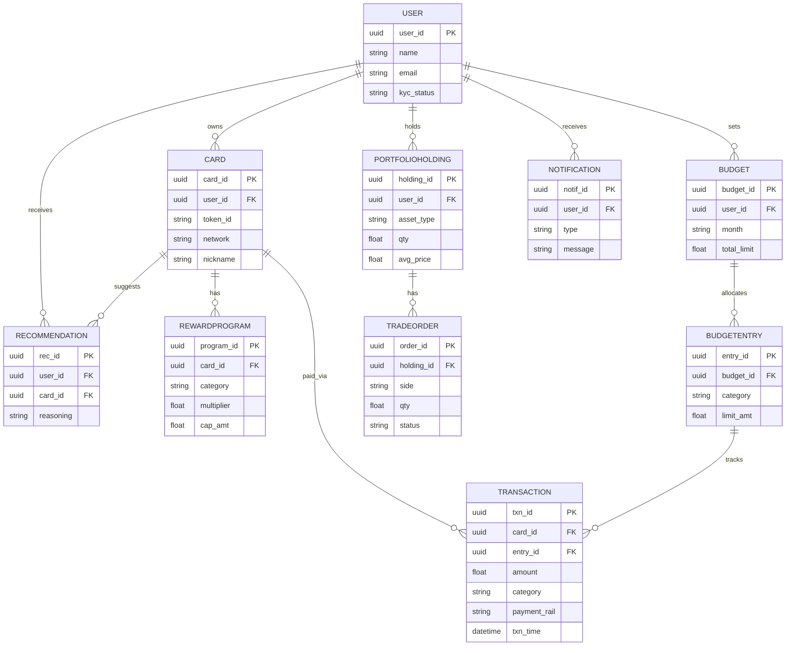

# SmartWallet — Entity-Relationship Diagram (Revised)

This revises the original 4-entity diagram (User, Card, Budget, Transaction) to cover all nine functional requirements (FR-1 through FR-9) in the SRS. See below for what changed and why.

## Changes from the original diagram

1. **Added `RewardProgram`** — required for FR-2 (automatic reward/benefit ingestion per card). Without it, `Card` had no way to store category multipliers, caps, or bonus windows.
2. **Added `PortfolioHolding` and `TradeOrder`** — required for FR-5 (view, buy, sell equities/MF/SIP/gold). The original diagram had no investment-related entities at all.
3. **Added `Notification`** — required for FR-7 (daily spend notifications) and FR-8 (month-end recommendations delivered as notifications).
4. **Added `Recommendation`** — stores the AI assistant's output and reasoning for FR-3, matching the Auditability NFR ("every financial action shall be logged immutably") and the `Recommendation` entity already named in the architecture doc's high-level data entities.
5. **Split `Budget` into `Budget` + `BudgetEntry`** — the original single `Budget` entity had one `limit_amt` for the whole month, which cannot represent FR-6's "category-wise limits." `BudgetEntry` now holds one row per category per budget.
6. **Re-routed the tracking relationship** — `Transaction` now links to `BudgetEntry` (not `Budget` directly), so it's clear which category-limit each transaction counts against.
7. **Added `payment_rail` and `txn_time` to `Transaction`** — required for FR-4 (UPI/NFC initiation) and for audit logging.

## Mermaid source

## FR coverage check

| Requirement | Entity/relationship that supports it |
|---|---|
| FR-1 (add/edit/delete cards) | `Card` |
| FR-2 (automatic reward ingestion) | `RewardProgram` (Card has\|\| REWARDPROGRAM) |
| FR-3 (best-card recommendation) | `Recommendation` (User/Card receives/suggests) |
| FR-4 (UPI/NFC payment) | `Transaction.payment_rail` |
| FR-5 (view/buy/sell investments) | `PortfolioHolding`, `TradeOrder` |
| FR-6 (category-wise budget) | `Budget` + `BudgetEntry` |
| FR-7 (daily notifications) | `Notification` |
| FR-8 (month-end recommendations) | `Notification` (type field distinguishes daily vs. month-end) |
| FR-9 (searchable transaction history) | `Transaction` (indexed by card_id, category, txn_time) |
